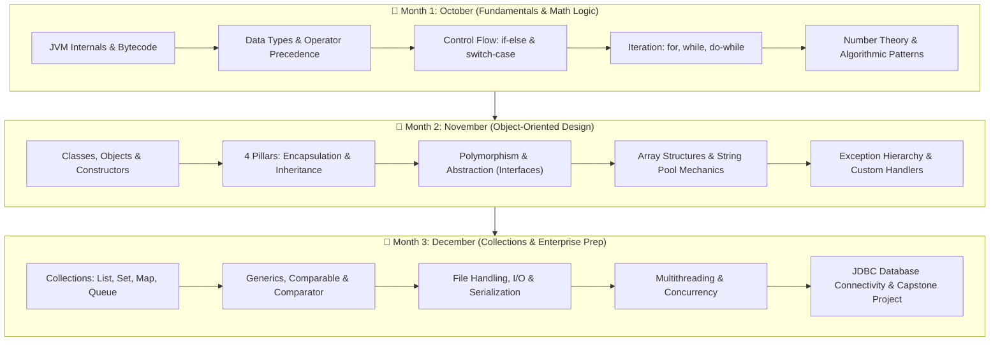

# <div align="center">☕ Kiran Academy — Java Developer Internship (3-Month Intensive)</div>

<div align="center">

[](https://www.oracle.com/java/)
[](https://www.thekiranacademy.com/)
[](#-internship-curriculum--syllabus)
[](#-internship-progress-matrix)

</div>

<div align="center">

[](https://git-scm.com/)
[](https://github.com/kasimshah19)
[](#-local-development--execution-guide)
[](#-engineering-standards--clean-code-guidelines)

</div>

---

## 📖 Executive Summary

Welcome to the central repository for my **3-Month Java Developer Internship** at **The Kiran Academy**. This repository documents an end-to-end, day-by-day practical coding journey spanning foundational programming concepts, algorithmic problem-solving, Object-Oriented Software Design (OOSD), data structures, the Java Collections Framework, and enterprise-grade backend development patterns.

Every single directory represents a discrete learning milestone containing standalone, modular Java programs engineered with clean architecture, zero redundant third-party dependencies, and zero-defect execution.

---

## 📋 Table of Contents

- [Executive Summary](#-executive-summary)
- [Internship Profile & Metadata](#-internship-profile--metadata)
- [Architecture & Repository Directory Layout](#-architecture--repository-directory-layout)
- [Internship Curriculum & Syllabus](#-internship-curriculum--syllabus)
  - [Month 1: October — Fundamentals, Control Flow & Math Logic](#-month-1-october--core-java-fundamentals--logic-building)
  - [Month 2: November — Object-Oriented Design, Arrays, Strings & Exceptions](#-month-2-november--object-oriented-software-design-oosd)
  - [Month 3: December — Collections Framework, Concurrency & Database Integration](#-month-3-december--collections-multithreading--enterprise-readiness)
- [Internship Progress Matrix](#-internship-progress-matrix)
- [Day 01 Detailed Case Study](#-day-01-detailed-case-study)
- [Local Development & Execution Guide](#-local-development--execution-guide)
- [Engineering Standards & Clean Code Guidelines](#-engineering-standards--clean-code-guidelines)
- [Key Learning Outcomes](#-key-learning-outcomes)
- [Author & Acknowledgments](#-author--acknowledgments)

---

## 📌 Internship Profile & Metadata

| Field | Details |
|:---|:---|
| **Candidate / Intern** | **Kasim Shah** ([@kasimshah19](https://github.com/kasimshah19)) |
| **Role Title** | Java Developer Intern |
| **Training Organization** | **The Kiran Academy**, Pune, Maharashtra |
| **Duration** | **3 Months** (October 2026 – December 2026) |
| **Core Technology** | Java Standard Edition (Java SE), JDK 8+ |
| **Methodology** | Daily hands-on coding, live faculty mentorship, practical implementation tasks |
| **Repository Type** | Academic & Professional Engineering Portfolio |

---

## 🏛️ Architecture & Repository Directory Layout

The workspace follows a strict hierarchical tree designed for modularity, traceability, and Git hygiene. Each month contains dedicated folders for every single calendar day:

```text
kiran-academy-java-internship/
├── 📁 October/                        # Month 1: 30 Calendar Days
│   ├── 📁 Day01_Task1/                # Basic Syntax, Printing & Arithmetic Operators
│   │   ├── Addition.java
│   │   ├── Difference.java
│   │   ├── Division.java
│   │   ├── Hello.java
│   │   ├── Modulus.java
│   │   └── Multiplication.java
│   ├── 📁 Day02_Task2/                # Conditional Logic & Branching
│   ├── 📁 Day03_Task3/                # Iterative Constructs & Number Logic
│   └── ... [Day04_Task4 to Day30_Task30]
│
├── 📁 November/                       # Month 2: 30 Calendar Days
│   ├── 📁 Day01_Task1/                # Class & Object Architecture
│   ├── 📁 Day02_Task2/                # Constructors & 'this' Reference
│   └── ... [Day03_Task3 to Day30_Task30]
│
├── 📁 December/                       # Month 3: 31 Calendar Days
│   ├── 📁 Day01_Task1/                # Java Collections Framework (Lists/Sets)
│   ├── 📁 Day02_Task2/                # Map Implementations & Hashing Mechanics
│   └── ... [Day03_Task3 to Day31_Task31]
│
└── 📄 README.md                       # Comprehensive Documentation & Curriculum Tracker
```

> **Design Choice:** All empty directories maintain a `.gitkeep` anchor file until active code is committed, ensuring GitHub mirrors the complete structural timeline throughout the 90 days.

---

## 🗺️ Internship Curriculum & Syllabus



---

### 🗓️ Month 1: October — Core Java Fundamentals & Logic Building

The first month establishes algorithmic rigor, memory understanding, and core language grammar.

- **Module 1.1: Platform Mechanics & Syntax**
  - Java Virtual Machine (JVM) internals, Just-In-Time (JIT) compilation, Java Runtime Environment (JRE), Java Development Kit (JDK).
  - Bytecode execution model and WORA (Write Once, Run Anywhere) principle.
  - Primitive Data Types (`byte`, `short`, `int`, `long`, `float`, `double`, `char`, `boolean`), range boundaries, variable declaration, and initialization semantics.
- **Module 1.2: Operators & Expressions**
  - Arithmetic operators (`+`, `-`, `*`, `/`, `%`) and explicit type-casting rules.
  - Relational, Logical (`&&`, `||`, `!`), Bitwise, Unary (`++`, `--`), and Ternary operators (`?:`).
  - Operator precedence and associativity tables.
- **Module 1.3: Control Flow Structures**
  - Decision making: `if`, `if-else`, `else-if` ladders, and nested branching.
  - Switch statements: traditional vs. modern expression forms with `break` and `default`.
- **Module 1.4: Iteration & Pattern Construction**
  - `while`, `do-while`, and traditional `for` loops.
  - Loop optimization, loop breaking (`break`), and skipping (`continue`).
  - Nested loops: Matrix printing, Star/Number pyramid patterns, and series generation.
- **Module 1.5: Computational Number Logic**
  - Prime checking, Armstrong numbers, Palindrome verification, Factorials, Fibonacci sequence, Reverse number, GCD & LCM calculations.

---

### 🗓️ Month 2: November — Object-Oriented Software Design (OOSD)

The second month shifts focus from procedural programming to scalable, component-based Object-Oriented Architecture.

- **Module 2.1: Class, Object & Memory Model**
  - Class definitions, instance instantiation, Heap vs. Stack memory allocation.
  - Constructors: Default, parameterized, constructor overloading, and constructor chaining with `this()`.
  - Static members: `static` variables, `static` methods, and `static` initialization blocks.
- **Module 2.2: The Four Pillars of OOP**
  - **Encapsulation:** Data hiding, getters/setters, access specifiers (`private`, `default`, `protected`, `public`).
  - **Inheritance:** `extends` keyword, Single, Multilevel, and Hierarchical inheritance; IS-A relationship; `super` keyword and `super()` constructor invocation.
  - **Polymorphism:** Compile-time (Method Overloading) vs. Runtime (Method Overriding with Dynamic Method Dispatch); `@Override` annotation.
  - **Abstraction:** Abstract classes vs. Pure interfaces; `implements` keyword, default and static interface methods.
- **Module 2.3: Arrays & In-Memory Data Collections**
  - Single-dimensional and Multi-dimensional arrays; array initialization and boundary handling.
  - Searching and sorting algorithms: Linear search, Binary search, Bubble sort, Selection sort.
- **Module 2.4: Deep Dive into Strings**
  - Immutability of `String`, String Constant Pool (SCP) in Heap memory.
  - Comparing `String`, `StringBuilder`, and `StringBuffer` (thread safety, performance benchmarks).
  - Common String manipulation methods (`substring`, `split`, `indexOf`, `replaceAll`, `toCharArray`).
- **Module 2.5: Robust Exception Handling**
  - Java Exception hierarchy: `Throwable` -> `Error` vs `Exception` (Checked vs Unchecked).
  - Structured error handling: `try`, `catch`, `finally` blocks, multi-catch syntax.
  - Throwing exceptions: `throw` vs `throws`, defining custom checked and unchecked business exceptions.

---

### 🗓️ Month 3: December — Collections, Multithreading & Enterprise Readiness

The final month prepares the codebase for production software systems, data structures, and database persistence.

- **Module 3.1: Java Collections Framework (JCF)**
  - Core interfaces: `Iterable`, `Collection`, `List`, `Set`, `Queue`, `Map`.
  - **List implementations:** `ArrayList` (dynamic array scaling) vs. `LinkedList` (doubly linked list nodes) vs. `Vector`.
  - **Set implementations:** `HashSet` (hashing algorithm), `LinkedHashSet` (insertion order), `TreeSet` (Red-Black Tree, sorted order).
  - **Map implementations:** `HashMap` internal mechanics (Hashing, Buckets, Collisions, Rehashing, Treeify threshold), `LinkedHashMap`, `TreeMap`.
- **Module 3.2: Generics & Object Ordering**
  - Type-safe programming with Generics (`<T>`, `<?>`, bounded wildcards).
  - Sorting custom objects using `Comparable<T>` (`compareTo()`) and `Comparator<T>` (`compare()`).
- **Module 3.3: Modern Java & Stream API**
  - Functional Interfaces and Lambda Expressions (`->`).
  - Stream pipeline operations: `filter()`, `map()`, `sorted()`, `collect()`, `forEach()`, `reduce()`.
- **Module 3.4: File I/O & Serialization**
  - Byte streams (`FileInputStream`/`FileOutputStream`) vs. Character streams (`FileReader`/`FileWriter`).
  - High-performance reading/writing with `BufferedReader` and `BufferedWriter`.
  - Object Serialization and Deserialization (`Serializable`, `transient` keyword).
- **Module 3.5: Multithreading & Concurrency Basics**
  - Thread creation via `Thread` class and `Runnable` interface.
  - Thread lifecycle states (NEW, RUNNABLE, BLOCKED, WAITING, TIMED_WAITING, TERMINATED).
  - Synchronization mechanisms: `synchronized` methods, synchronized blocks, and race condition prevention.
- **Module 3.6: Database Persistence (JDBC) & Capstone Project**
  - JDBC Architecture: `DriverManager`, `Connection`, `Statement`, `PreparedStatement`, `ResultSet`.
  - Performing atomic CRUD operations against relational databases (MySQL/PostgreSQL).
  - End-to-end Console Application / Mini-Project integrating OOP, Collections, and File/DB storage.

---

## 📊 Internship Progress Matrix

| Period | Target Days | Code Status | Verified Tasks | Key Competencies Covered |
|:---|:---:|:---:|:---:|:---|
| **Month 1 — October** | 30 Days | 🟢 **In Progress** | `Day01_Task1` (Completed) | Syntax, Arithmetic Operators, Data Types, Control Logic |
| **Month 2 — November** | 30 Days | ⏳ Scheduled | Structure Ready (`.gitkeep`) | OOP Principles, Inheritance, Polymorphism, Arrays, Exceptions |
| **Month 3 — December** | 31 Days | ⏳ Scheduled | Structure Ready (`.gitkeep`) | Collections Framework, Streams, File I/O, JDBC Capstone |
| **Total Program** | **91 Days** | **Active Tracking** | **1 Day (6 Java Programs)** | **Full Stack Core Java Competence** |

---

## 🌟 Day 01 Detailed Case Study

The internship commenced on **Day 01** with fundamental console output, variable allocation, and arithmetic operators in [`October/Day01_Task1`](./October/Day01_Task1).

### Implementation Overview
```
Variables used for computation: a = 20, b = 3
```

| Source File | Primary Concept Demonstrated | Formula / Operation | Actual Console Output |
|:---|:---|:---:|:---|
| [`Hello.java`](./October/Day01_Task1/Hello.java) | Environment sanity & console printing | Standard Out | `Hello World` |
| [`Addition.java`](./October/Day01_Task1/Addition.java) | Addition operator with int variables | `a + b` | `Addition of 20 and 3 = 23` |
| [`Difference.java`](./October/Day01_Task1/Difference.java) | Subtraction operator with int variables | `a - b` | `Difference of 20 and 3 = 17` |
| [`Multiplication.java`](./October/Day01_Task1/Multiplication.java) | Multiplication operator | `a * b` | `Multiplication of 20 and 3 = 60` |
| [`Division.java`](./October/Day01_Task1/Division.java) | Explicit floating-point type casting | `(double) a / b` | `Division of 20 and 3 = 6.666666666666667` |
| [`Modulus.java`](./October/Day01_Task1/Modulus.java) | Modulo operator (remainder computation) | `a % b` | `Modulus of 20 and 3 = 2` |

> **Key Observation in [`Division.java`](./October/Day01_Task1/Division.java):** Without explicit casting, integer division `20 / 3` truncates the decimal to `6`. By casting `(double) a / b`, standard IEEE 754 double-precision arithmetic is enforced, yielding the accurate recurring fractional result `6.666666666666667`.

---

## 💻 Local Development & Execution Guide

### 1. System Requirements & Verification
Confirm that a valid Java Development Kit (JDK 8, 11, 17, or 21) is installed and mapped in your system `PATH`:

```bash
# Check Java runtime version
java -version

# Check Java compiler version
javac -version
```

### 2. Cloning the Repository
```bash
git clone https://github.com/kasimshah19/kiran-academy-java-internship.git
cd kiran-academy-java-internship
```

### 3. Compiling & Running Programs

#### Option A: Running from the Workspace Root
```bash
# Compile specific file
javac October/Day01_Task1/Addition.java

# Execute using classpath targeting the directory
java -cp October/Day01_Task1 Addition
```

#### Option B: Running from Inside the Task Directory
```bash
cd October/Day01_Task1
javac Division.java
java Division
```

#### Option C: One-Liner Batch Execution (PowerShell)
```powershell
Get-ChildItem -Filter *.java | ForEach-Object { 
    javac $_.Name; 
    Write-Host "`n=== $($_.BaseName) ==="; 
    java $_.BaseName; 
    Remove-Item "$($_.BaseName).class" 
}
```

---

## 🧼 Engineering Standards & Clean Code Guidelines

Every single task committed to this repository adheres to established industry best practices:

1. **Standard Java Naming Conventions:**
   - **Classes:** `PascalCase` (e.g., `Multiplication`, `CustomerOrderManager`).
   - **Variables & Methods:** `camelCase` (e.g., `totalAmount`, `calculateInterestRate`).
   - **Constants:** `ALL_CAPS_SNAKE_CASE` (e.g., `MAX_RETRY_COUNT`).
2. **Atomic Modularity:** Each `.java` file is self-contained with its own `public static void main(String[] args)` entrypoint, enabling independent testing and review.
3. **Zero Git Noise:** No compiler artifacts (`.class` files), OS-generated metadata (`.DS_Store`, `Thumbs.db`), or IDE configuration directories (`.idea/`, `.vscode/`) are tracked in version control.
4. **Predictable Output Formatting:** Outputs follow standardized, readable templates (e.g., `"Operation of A and B = Result"`).

---

## 🎯 Key Learning Outcomes

Upon completion of this 3-month internship, this repository will demonstrate proficiency in:

- [x] Writing structured, bug-free, compilable Core Java code from scratch.
- [ ] Designing modular object graphs applying SOLID principles and OOP paradigms.
- [ ] Selecting optimal data structures (`ArrayList` vs `LinkedList`, `HashMap` vs `TreeMap`) based on Big-O time and space complexity.
- [ ] Handling edge cases, invalid inputs, and runtime exceptions gracefully.
- [ ] Implementing database integration (JDBC) and persistent data processing.
- [ ] Maintaining industry-standard version control workflows on GitHub.

---

## 👤 Author & Acknowledgments

- **Intern / Developer:** **Kasim Shah**
  - **GitHub:** [@kasimshah19](https://github.com/kasimshah19)
  - **Repository:** [kiran-academy-java-internship](https://github.com/kasimshah19/kiran-academy-java-internship)
- **Training Institution:** [The Kiran Academy](https://www.thekiranacademy.com/), Pune, India
- **Mentors & Instructors:** Sincere gratitude to the mentors and training leads at Kiran Academy for continuous code reviews, theoretical depth, and industry-oriented practical exposure.

---

<div align="center">
  <b>⭐ If this repository adds value to your Core Java learning journey, consider starring the repo! ⭐</b><br>
  <i>Built with passion, consistency, and clean code principles.</i>
</div>
