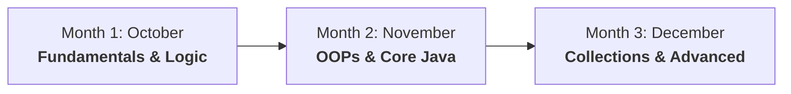

# ☕ Kiran Academy — Java Developer Internship (3 Months)

[](https://www.oracle.com/java/)
[](#curriculum--roadmap)
[](#about-the-program)
[](#progress-tracker)

Welcome to my official repository for the **3-Month Java Developer Internship** at **The Kiran Academy**. This repository serves as a systematic, day-by-day record of practical coding assignments, problem-solving implementations, and core engineering concepts developed throughout the training program.

---

## 📌 Table of Contents

- [About the Program](#-about-the-program)
- [Repository Structure](#-repository-structure)
- [Curriculum & Roadmap](#-curriculum--roadmap)
- [Daily Progress Tracker](#-daily-progress-tracker)
- [Day 01 Spotlight](#-day-01-spotlight)
- [How to Run Locally](#-how-to-run-locally)
- [Coding Standards & Best Practices](#-coding-standards--best-practices)
- [Author & Acknowledgments](#-author--acknowledgments)

---

## 🎯 About the Program

The Kiran Academy internship is an intensive, hands-on training program designed to transform foundational knowledge into production-ready software engineering skills. 

### Key Highlights:
- **Duration:** 3 Months (October → December)
- **Learning Model:** Daily practical tasks with real-world coding problems
- **Core Focus:** Clean code, algorithmic thinking, robust OOP design, and debugging proficiency

---

## 🗂️ Repository Structure

The workspace is organized month-by-month, with each day structured into an isolated task package for modularity and easy review:

```text
kiran-academy-java-internship/
├── October/              # Month 1: Java Basics, Control Flow & Math Logic
│   ├── Day01_Task1/      # Basic Syntax & Arithmetic Operations
│   ├── Day02_Task2/
│   └── ... Day30_Task30/
├── November/             # Month 2: OOPs, Arrays, Strings & Exception Handling
│   ├── Day01_Task1/
│   └── ... Day30_Task30/
├── December/             # Month 3: Collections Framework, Streams & Mini-Projects
│   ├── Day01_Task1/
│   └── ... Day31_Task31/
└── README.md
```

---

## 🗺️ Curriculum & Roadmap



### 🗓️ Month 1 — October: Fundamentals & Logic Building
- Java Architecture, JVM, JRE, JDK internals
- Data Types, Literals, Variables & Memory Model
- Arithmetic, Relational, Logical, and Bitwise Operators
- Conditional Statements (`if-else`, nested conditions, `switch-case`)
- Looping Constructs (`for`, `while`, `do-while`, nested loops)
- Number-theory & Logic-building problems (Primes, Fibonacci, Factorials, Palindromes)

### 🗓️ Month 2 — November: Object-Oriented Programming (OOP)
- Classes, Objects, Constructors, and `this` reference
- Encapsulation, Access Modifiers, and Package management
- Inheritance (`single`, `multilevel`, `hierarchical`) and `super` keyword
- Polymorphism (Compile-time Method Overloading & Runtime Method Overriding)
- Abstraction: Abstract Classes vs. Interfaces
- Arrays (1D, 2D, Multidimensional) & String Manipulation (`String`, `StringBuilder`, `StringBuffer`)
- Exception Handling (`try-catch-finally`, `throw`, `throws`, Custom Exceptions)

### 🗓️ Month 3 — December: Collections & Industry-Ready Concepts
- Java Collections Framework (`List`, `Set`, `Map`, `Queue` implementations)
- Generics, Iterators, and Comparable / Comparator interfaces
- File I/O (`FileInputStream`, `BufferedReader`, Serialization)
- Multithreading & Concurrency fundamentals
- Introduction to JDBC (Java Database Connectivity) & CRUD operations
- Comprehensive Capstone / Mini-Project implementation

---

## 📊 Daily Progress Tracker

| Month | Days Total | Status | Focus Area |
|:---:|:---:|:---:|:---|
| **October** | 30 Days | 🟢 **In Progress** | Syntax, Operators, Control Flow & Logic |
| **November** | 30 Days | ⏳ Scheduled | OOPs, Arrays, Strings & Exception Handling |
| **December** | 31 Days | ⏳ Scheduled | Collections, File I/O, JDBC & Capstone Projects |

---

## 🌟 Day 01 Spotlight

The internship kicked off on **Day 01** with foundational Java syntax and arithmetic logic in [`October/Day01_Task1`](./October/Day01_Task1):

| File | Purpose | Sample Output |
|:---|:---|:---|
| [`Hello.java`](./October/Day01_Task1/Hello.java) | Environment check & standard console output | `Hello World` |
| [`Addition.java`](./October/Day01_Task1/Addition.java) | Integer addition using operators | `Addition of 20 and 3 = 23` |
| [`Difference.java`](./October/Day01_Task1/Difference.java) | Subtraction & variable assignment | `Difference of 20 and 3 = 17` |
| [`Multiplication.java`](./October/Day01_Task1/Multiplication.java) | Multiplication computation | `Multiplication of 20 and 3 = 60` |
| [`Division.java`](./October/Day01_Task1/Division.java) | Division with type-casting (`(double) a / b`) | `Division of 20 and 3 = 6.666666666666667` |
| [`Modulus.java`](./October/Day01_Task1/Modulus.java) | Remainder computation using `%` operator | `Modulus of 20 and 3 = 2` |

---

## 💻 How to Run Locally

### Prerequisites
Make sure you have JDK (Java Development Kit) 8 or higher installed:
```bash
java -version
javac -version
```

### Clone the Repository
```bash
git clone https://github.com/kasimshah19/kiran-academy-java-internship.git
cd kiran-academy-java-internship
```

### Compile & Execute Any Task
Navigate to any target task folder and run:
```bash
# Example: Running Day 01 Division Task
cd October/Day01_Task1
javac Division.java
java Division
```

---

## 🧼 Coding Standards & Best Practices

Throughout this internship, the following engineering practices are strictly maintained:
- **Clean Code:** Standard Java naming conventions (PascalCase for classes, camelCase for variables/methods).
- **Independent Execution:** Each task contains its own runnable `main()` entrypoint.
- **Git Hygiene:** No compiled artifacts (`.class` binaries) tracked; only clean source code.
- **Precision:** Explicit type casting where arithmetic precision matters.

---

## 👤 Author & Acknowledgments

- **Intern:** Kasim Shah ([@kasimshah19](https://github.com/kasimshah19))
- **Training Institute:** [The Kiran Academy](https://www.thekiranacademy.com/)
- **Mentorship:** Faculty & Mentors at Kiran Academy for continuous guidance and industry-oriented training.

---

<p align="center">
  <i>⭐ If you find this repository helpful for your own Core Java learning journey, consider giving it a star!</i>
</p>
